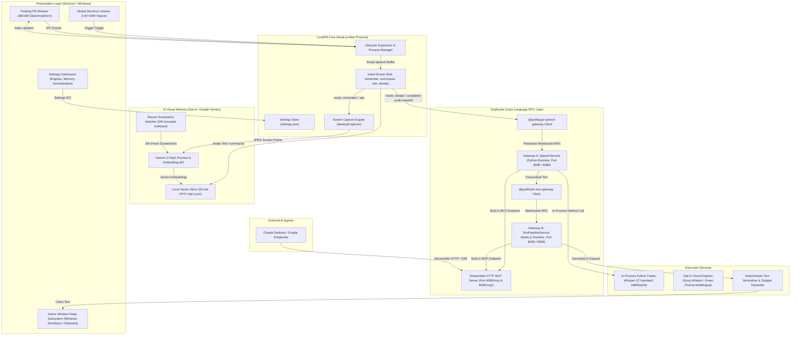

# LocalPill

> A private, low-latency voice layer and visual memory assistant for Windows applications and AI agents, powered by Graftcode cross-language RPC.

---

## Quick Start

### Prerequisites
* **Operating System:** Windows 10 or Windows 11 (x64)
* **Node.js:** v18.0.0 or later (v20+ recommended)
* **Python:** 3.10 to 3.13 (x64)
* **Graftcode Gateway:** `gg.exe` version **v1.4.11** placed in the project root directory.

### Setup & Launch
From an elevated or standard PowerShell terminal in the project root:

```powershell
# 1. Automated environment setup
# Verifies gg.exe, initializes .env, configures Python venv, caches Whisper models, and installs Node modules
powershell -ExecutionPolicy Bypass -File scripts\setup.ps1

# 2. Launch LocalPill
npm start
```

Press `Ctrl+Shift+Space` anywhere in Windows, speak, and clean, normalized text pastes directly at your cursor.

---

## Offline Speech vs. Opt-In Cloud Features

LocalPill is designed with a strict architectural separation between local and cloud operations:

| Feature | Execution Environment | Network Requirement | External Privacy |
| :--- | :--- | :--- | :--- |
| **Speech-to-Text Dictation** | Local Faster-Whisper (`whisper-base`, `whisper-tiny`, `whisper-small` via CTranslate2 CPU/GPU) | **100% Offline** | Zero network egress. Audio processed in local memory/temp disk and purged immediately. |
| **Text Normalization & Snippets** | Local Node.js / Graftcode Gateway B | **100% Offline** | Zero network egress. Punctuation conversion, filler word removal, and snippet expansion run entirely on host. |
| **Model Context Protocol (MCP)** | Local Graftcode Gateway A (`:8085/mcp`) & Gateway B (`:8095/mcp`) | **100% Localhost** | Access limited strictly to `%USERPROFILE%\LocalPillRecordings`. No cloud telemetry. |
| **Groq Whisper Fallback** | Optional Cloud Engine (`whisper-large-v3-turbo`) | Internet Connection | **Opt-in only:** Requires user-configured `GROQ_API_KEY`. Audio sent to Groq API only when explicitly selected in Settings. |
| **Gnani Prisma Multilingual STT** | Optional Cloud Engine (`prisma-v3.0`, Indian languages) | Internet Connection | **Opt-in only:** Requires user-configured `GNANI_API_KEY`. Supports Hinglish, Hindi, Tamil, Bengali, Telugu, Kannada, Marathi, Gujarati. |
| **Gemini Visual Memory & Screen Assistant** | Cloud Multimodal Reasoning (Google Gemini 3 Flash) | Internet Connection | **Opt-in only:** Requires user-configured `GEMINI_API_KEY`. Triggered strictly by intentional voice commands (*"remember this"*, *"ask what this error means"*). |

If `GEMINI_API_KEY`, `GROQ_API_KEY`, or `GNANI_API_KEY` are not provided in `.env`, all cloud capabilities remain inactive while 100% of local voice dictation, engine switching, and MCP tools function seamlessly offline.

### Selectable Visual Memory Modes
Under **Settings > Assistant**, users can switch between two distinct memory architectures based on their privacy preferences:
* **Hybrid Mode (Default):** Watches your local Windows Screenshots folder in the background (within a configurable lookback window up to 72 hours) and captures on-demand snapshots whenever you speak *"remember this"*.
* **Intentional-Only Mode:** Strict privacy mode where the background folder watcher is completely idle. LocalPill never touches or scans your Screenshots folder; it captures and indexes an image only when you explicitly command *"remember this"* (or *"remember me"*).

---

## Architectural Diagram



---

## What Graftcode Is Doing in This Project

In cross-language desktop applications, two core requirements conflict:
1. **The Desktop UI & System Integration Layer** requires Node.js / Electron for native Windows API bindings, global hotkeys, floating frameless windows, tray menus, and active-window paste injection.
2. **The High-Performance Inference Layer** requires Python to access native CTranslate2 execution engines, CUDA bindings, and PyTorch ecosystem libraries.

Traditionally, developers bridge Electron and Python using ad-hoc HTTP REST servers (FastAPI/Flask) or by spawning child processes (such as `curl.exe` or CLI wrappers). This introduces significant drawbacks:
* Spawning CLI processes on Windows introduces **13 ms to 50 ms** of child-process initialization overhead per call.
* REST servers require hundreds of lines of boilerplate for route handling, body parsing, CORS headers, status codes, and socket timeouts.
* Zero compile-time type safety across language boundaries, leading to runtime schema drift.
* Manual implementation of Model Context Protocol (MCP) endpoints requires custom SSE or Streamable HTTP servers.

### How Graftcode Solves This

LocalPill uses Graftcode as the **backbone cross-language communication and microservice orchestration framework**:

1. **Direct Python Hosting & Typed Client SDKs:**
   * Graftcode Gateway A (`gg.exe --runtime python --modules services/speech`) hosts the Python `SpeechService` directly in-process via CPython.
   * Discovers Python type annotations and publishes `@graft/pypi-speech-gateway`. Electron imports the typed client and calls `SpeechService.transcribeBytesJson(base64Audio, prompt)` as if it were a local JavaScript function.
2. **Persistent WebSocket RPC:**
   * When dictation finishes, the completed audio recording is base64-encoded and transmitted over a persistent WebSocket connection directly to Gateway A.
   * Eliminates connection setup, socket teardown, and process spawning overhead.
3. **Supervisor & Fault-Tolerant Auto-Recovery:**
   * The Electron main supervisor (`ProcessSupervisor`) monitors the health of Gateway A and Gateway B over loopback.
   * If a gateway encounters an unexpected issue, the supervisor initiates automated exponential backoff recovery without freezing the UI or losing state.
4. **Zero-Code Model Context Protocol (MCP) Exposure:**
   * Graftcode Gateway automatically exposes public methods as standard MCP endpoints on `http://localhost:8085/mcp` and `http://localhost:8095/mcp`.
   * AI agents like Claude Desktop or Google Antigravity can connect directly to transcribe recordings within a sandboxed directory without any custom plugins.

---

## Empirical Benchmark & Performance Analysis

LocalPill includes an automated, reproducible benchmark harness (`scripts/benchmark.mjs`) that compares direct Graftcode WebSocket RPC against loopback HTTP REST and child-process CLI bridges on the host machine.

### Benchmark Setup
* **Host Platform:** Windows 11 x64 (12th Gen Intel Core i5-12450HX, 12 cores, 16 GB RAM)
* **Active Engine:** `whisper-base` (CTranslate2 int8 on CPU)
* **Gateway Version:** Graftcode Gateway `v1.4.11`
* **Command:** `npm run benchmark`

### 1. Transport & Ping Latency (N=50 calls, 5 warm-ups)
Measures operational ping and metadata queries without neural model inference:

| Architecture | Min | Median (p50) | p95 | Average | Transport Characteristics |
| :--- | :---: | :---: | :---: | :---: | :--- |
| **Direct Graftcode WebSocket RPC** (`@graft/pypi-speech-gateway`) | 0.18 ms | **0.39 ms** | 1.21 ms | 0.51 ms | Persistent WebSocket frame; zero socket or process overhead |
| **In-Process HTTP REST** (`GET /health`) | 0.54 ms | **0.74 ms** | 1.44 ms | 0.81 ms | HTTP socket handshake and header parsing |
| **Subprocess `curl.exe` Bridge** (`execFile curl.exe`) | 13.07 ms | **13.80 ms** | 35.49 ms | 16.65 ms | Windows child-process creation penalty (+13 to 35 ms) |

### 2. 1.0s Audio Clip End-to-End Transcription (N=5 calls, 2 warm-ups)
Transcribing a 1.0-second 16 kHz mono audio sample on `whisper-base`:

| Architecture | Min | Median (p50) | p95 | Average |
| :--- | :---: | :---: | :---: | :---: |
| **Direct Graftcode WebSocket RPC** (`SpeechService.transcribeBytesJson`) | 1179.49 ms | **1207.71 ms** | 1390.06 ms | **1246.97 ms** |
| **In-Process HTTP REST** (`POST /transcribe`) | 1059.20 ms | **1072.29 ms** | 1134.04 ms | **1088.47 ms** |
| **Subprocess `curl.exe` Bridge** (`curl.exe --data-binary`) | 1041.29 ms | **1054.05 ms** | 1083.56 ms | **1058.76 ms** |

### Where Latency Lives:
1. **Model Inference Dominates End-to-End Time:**
   For a 1.0-second audio clip on CPU int8, neural inference requires **~1100–1200 ms**. Network transport accounts for less than 1.5% of total turnaround time.
2. **Audio Payload Encoding:**
   Completed recordings are base64-encoded by the Electron audio recorder and sent to `transcribeBytesJson`. Transmitting ~40 KB to 200 KB of base64 audio over localhost WebSocket takes under 1 ms.
3. **The True Cost of Subprocess Bridges:**
   Spawning external CLI tools (`curl.exe`) or creating ad-hoc processes introduces **13 ms to 50 ms** of Windows process-creation overhead and process management complexity. Graftcode completely eliminates child-process spawning by hosting Python in-process inside `gg.exe`.

---

## Integration Code Removed by Graftcode

Hosting the Python speech service directly through Graftcode Gateway removes extensive boilerplate:

| Layer | Manual REST / CLI Bridge | With Graftcode Direct Integration |
| :--- | :--- | :--- |
| **Backend HTTP Routing** | 190 lines of custom HTTP server (`BaseHTTPRequestHandler`), path routers, Content-Length parsers, CORS headers, status codes | **0 lines:** Graftcode Gateway auto-discovers Python classes and methods directly |
| **Client Transport Code** | 130+ lines of Node.js `http.request`, buffer streaming, error parsers, connection retry loops | **0 lines:** Auto-generated typed client (`@graft/pypi-speech-gateway`) |
| **Subprocess / CLI Bridge** | Child process spawning logic, temporary file creation/deletion, argument escaping | **0 lines:** Direct in-process RPC over persistent WebSocket connection |
| **Model Context Protocol (MCP)** | Writing custom SSE / Streamable HTTP servers for external AI tools | **0 lines:** Built-in standard MCP endpoints automatically exposed at `http://localhost:8085/mcp` |
| **Type Safety & Contracts** | Manual schema documentation and runtime validation prone to contract drift | Generated typed SDK with method signatures reflecting Python types |

---

## Graftcode Gateway & Package Management

### Gateway Details
* **Executable:** `gg.exe`
* **Version:** `1.4.11`
* **Hosted Runtimes:**
  * Gateway A: `python` (pointing to `services/speech`, WebSocket port 8085, HTTP/Vision port 8086)
  * Gateway B: `nodejs` (pointing to `services/text_gateway/index.js`, WebSocket port 8095, HTTP/Vision port 8096)

### How Graft Packages Are Generated & Installed via Vision
1. **Launch Gateway with Module:**
   ```powershell
   .\gg.exe --runtime python --modules services/speech --port 8085 --httpPort 8086
   ```
2. **Graftcode Vision Dashboard:**
   Open `http://localhost:8085` or `http://localhost:8086` in any browser to inspect the auto-discovered services (`SpeechService`), method signatures, and live test RPC calls.
3. **Package Generation & Publication:**
   Graftcode automatically extracts the module metadata, types, and method schemas into a Universal Graft Module (UGM) and publishes the client SDK to the private Graftcode registry:
   * Package: `@graft/pypi-speech-gateway`
   * Target Registry: `https://grft.dev/3e5baa8a-b08a-4d37-b4b6-d0de29c389bc__free`
4. **Client Installation:**
   ```powershell
   npm install @graft/pypi-speech-gateway --registry https://grft.dev/3e5baa8a-b08a-4d37-b4b6-d0de29c389bc__free
   ```

---

## Privacy & Security Sandbox

- **Zero External Audio Egress:** In local engine mode, voice recording, Whisper transcription, and text sanitization execute 100% locally on your machine.
- **Log Privacy by Default:** Transcripts and audio are never written to disk logs (`LOG_TRANSCRIPTS=false`).
- **Temporary File Sanitization:** Audio clips written to `%TEMP%\LocalPill\` are purged immediately upon transcription. The supervisor sweeps any orphaned audio files on launch and exit.
- **MCP Security Boundary:** The MCP tool `TranscribeFileJson` only accesses files inside `%USERPROFILE%\LocalPillRecordings`. Directory traversal (`..\..\`), Windows NTFS Directory Junctions, and symlink escapes are resolved via `os.path.realpath` and strictly blocked with `PathNotAllowedException`. File extension whitelisting (`.wav`, `.mp3`, `.m4a`, `.webm`, `.ogg`, `.flac`) and empty-file rejection are enforced.
- **Bounded Screenshot Retention:** Screenshot memory enforces a 25-entry FIFO cap and a 24-hour lookback filter. Historical image archives are never indexed or transmitted.

---

## Using with Claude Desktop & Antigravity (MCP)

LocalPill exposes its capabilities as native tools for AI assistants.

### Claude Desktop (`%APPDATA%\Claude\claude_desktop_config.json`)
```json
{
  "mcpServers": {
    "localpill-speech": {
      "command": "npx",
      "args": ["-y", "mcp-remote", "http://localhost:8085/mcp"]
    },
    "localpill-text": {
      "command": "npx",
      "args": ["-y", "mcp-remote", "http://localhost:8095/mcp"]
    }
  }
}
```

### Google Antigravity (`~/.gemini/config/mcp_config.json`)
```json
{
  "mcpServers": {
    "localpill-speech": {
      "serverUrl": "http://localhost:8085/mcp"
    },
    "localpill-text": {
      "serverUrl": "http://localhost:8095/mcp"
    }
  }
}
```

---

## Automated Test Suites & Verification

LocalPill includes comprehensive test suites on Windows:

```powershell
# Run core test suite (Text pipeline, supervisor reliability, speech service)
npm test

# Run reproducible architecture and latency benchmark
npm run benchmark

# Run MCP integration & security boundary tests
npm run test:mcp

# Run live engine swap tests
npm run test:engines

# Run AI assistant, intent routing, and vector memory tests
npm run test:assistant

# Run Chaos test (mid-session Gateway killing & auto-recovery)
npm run test:chaos

# Run Python speech service unit tests directly
npm run test:speech
```
